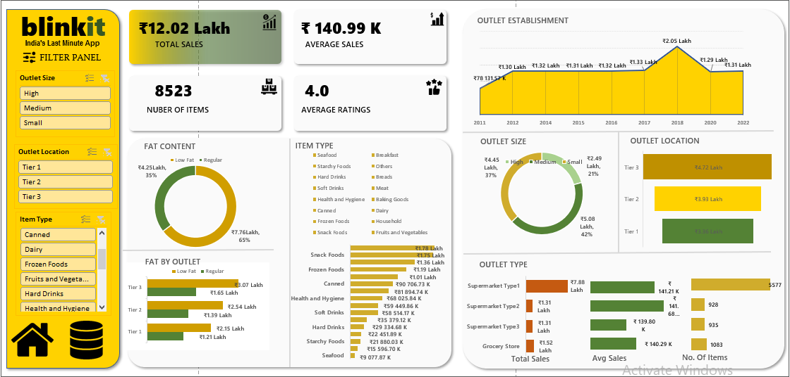

# 🛒 Blinkit Sales Dashboard | Excel

## 📌 Project Overview
This project focuses on analyzing Blinkit grocery sales data using Microsoft Excel 2021. An interactive dashboard was developed to track key performance indicators (KPIs), compare outlet performance, and analyze product-level sales trends.

## 🎯 Project Objectives
- Analyze overall sales performance.
- Compare sales across different outlet sizes and location tiers.
- Understand sales distribution by item type and fat content.
- Explore outlet establishment year and outlet type performance.
- Build an interactive dashboard for business reporting.

## 🛠️ Tools & Skills
- Microsoft Excel 
- Data Cleaning
- PivotTables and PivotCharts
- KPI Development
- Interactive Slicers
- Data Visualization

## 📊 Key Performance Indicators
- **Total Sales:** Total sales value across the dataset.
- **Average Sales:** Average sales value per item record.
- **Number of Items:** Total item records analyzed.
- **Average Rating:** Average customer rating.

## 📈 Dashboard Features
- Interactive slicers for Outlet Size, Outlet Location, and Item Type.
- Sales analysis by item type.
- Low Fat vs. Regular product sales comparison.
- Outlet size and location tier comparisons.
- Outlet establishment year analysis.
- Outlet type performance comparison.

## 🖼️ Dashboard Preview

## 💡 Analysis Opportunities
The dashboard allows users to investigate:
- Which item categories contribute most to total sales.
- How sales vary by outlet size and location.
- Differences in sales across outlet establishment years.
- Sales contributions from Low Fat and Regular products.
- Performance differences across outlet types.

## 📁 Project Files
- `Blinkit_Sales_Dashboard.xlsx` — Interactive Excel dashboard and workbook.
- `Blinkit_Dashboard_Merged.png` — Dashboard preview image.

## 👨‍💻 About Me
I am a B.Tech Computer Science student specializing in Data Science, building practical skills in data analytics, Excel, and business intelligence through hands-on projects.

This project is part of my Data Analyst learning journey.
